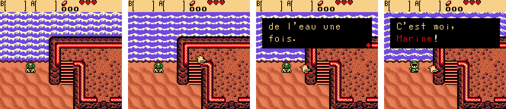

🇫🇷 [Version française](README.md)

# The Legend of Zelda: Gulls of Life

*The Ballad of the Seagull*: the sequel to **Link's Awakening**, as a Game Boy
Color ROM hack.

The Wind Fish woke up and Koholint Island vanished… but not entirely. Marin
made a wish: to have wings and fly beyond the sea. She comes back as a
**seagull**, and joins Link on an archipelago where nobody dreams anymore.

*Gulls of Life*: *gulls* sounds like *goals*. That's the moral of the game:
you make your dreams come true instead of staying in them, and you keep going
no matter what.




## Status

| Part | Status |
| --- | --- |
| New game: no *Ages* intro, Link wakes up on a beach | ✅ |
| Marin as a seagull (sprite drawn for the game, with her hibiscus flower) | ✅ |
| Chapter 1: Link lies unconscious, Marin flies in, lands and talks to him (with a choice), then snuggles into Link's tunic | ✅ |
| French text, with accents (the game is in French first) | ✅ |
| Opening film before the title screen: at dawn, Link drifts on his log and looks up; Marin's face appears in the clouds (like *Link's Awakening*'s secret ending) and fades away; a seagull flies out of it and lands, "?", a wink, "!", they both jump for joy and their hearts fly up | ✅ |
| *Gulls of Life* title screen (currently *Ages*') | to do |
| Marin travels in Link's tunic: she speaks at key moments, you can ask her for a hint | to do |
| Sleeping to enter the Dream World (where Marin is human again) | to do |
| Port-Veille, the Dark Lighthouse and its boss, the first verse of Marin's song | to do |
| Music: Marin's song | to do |

## How it's made

The game runs on the **Oracle of Ages engine**, thanks to Stewmath's complete
disassembly [oracles-disasm](https://github.com/Stewmath/oracles-disasm)
(`hack-base` branch, meant for hacks). The present/past switch of *Ages* will
become the Real World / Dream World switch.

| What | Where |
| --- | --- |
| Code, scripts, data | [`hack/gulls-of-life`](https://github.com/soaresden/oracles-disasm/tree/hack/gulls-of-life) branch of the fork (additions tagged `BALLADE`): `scripts/ages/ballade.s`, `object_code/ages/interactions/marine.s` |
| Dialogue | `story/textes.yaml`, plain French; `tools/make_text.py` adds it to the game, `tools/check_text.py` checks line width (16 characters) |
| Sprites | Text drawings in `art/`; `tools/make_sprites.py` converts them |
| Opening film | `code/ages/cutscenes/film.s` (fork); background and sprites made by `tools/make_film.py` (sky and clouds, sun, sea, log, Link poses taken from the game, Marin's face); `tools/preview_film.py` previews it without building |
| Tests | `tools/play.py` plays the ROM in PyBoy and takes screenshots |

No ROM is distributed here: there will be a patch to apply to your own
*Oracle of Ages* (USA) ROM.

## Building (Windows)

Requirements: [MSYS2](https://www.msys2.org/) in `C:\msys64` (with `cmake`,
`make`, `mingw-w64-x86_64-gcc`) and Python 3 with
`pip install pyyaml pillow pyboy`. From Git Bash:

```bash
./setup.sh
```

```bash
./build.sh
```

The ROM is written to `out/gulls_of_life.gbc`.
