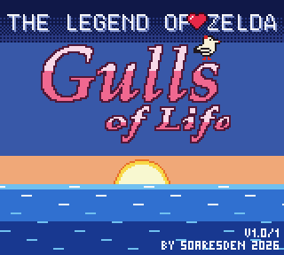

🇬🇧 [English version](README.en.md)

**▶ [La page du jeu](https://soaresden.github.io/ZeldaGullsOfLife/)**

# The Legend of Zelda: Gulls of Life

*La Ballade de la Mouette* : la suite de **Link's Awakening**, en ROM hack
Game Boy Color.

Le Poisson-Rêve s'est réveillé et l'île Cocolint a disparu… mais pas tout à
fait. Marine a fait un vœu : avoir des ailes pour partir au-delà de la mer. Elle
revient en **mouette**, et elle accompagne Link dans un archipel où plus
personne ne rêve.

*Gulls of Life* : *gulls* (les mouettes) sonne comme *goals* (les buts). C'est
la morale du jeu : on réalise ses rêves, on n'y reste pas, et on avance malgré
les obstacles.

<p align="center"></p>


Pourquoi les rêves se sont-ils éteints ? Et que reste-t-il de Cocolint… quand
on ferme les yeux ? Le reste, c'est à vous de le découvrir.

## Ce qui vous attend

Un vrai Zelda, fait pour la Game Boy Color : de nouvelles îles, de nouveaux
donjons, de nouvelles musiques. Et une mouette qui a son mot à dire.

- ♪ **Des musiques originales**, composées note à note pour le jeu : une ballade
  tendre à l'écran titre, l'air des îles, la chaleur de l'auberge, le vent
  autour du phare…
- ★ **Une musique épique** : quand le combat commence, l'orchestre se déchaîne,
  tenu dans les quatre voix de la Game Boy.
- ♫ **Un nouveau thème** : la *Ballade de la Mouette*, douce puis furieuse, que
  vous entendrez sous bien des formes.
- ☾ **De nouvelles mécaniques** : le rêve et l'éveil ne jouent pas selon les
  mêmes règles. Apprenez les deux… et servez-vous de l'un contre l'autre.
- ◆ **De nouveaux mini-jeux** : une île sans jeux, ce n'est pas une île de Zelda.
  Les deux démineurs du forain, un labyrinthe à la Pac-Man avec des Lynels aux
  trousses, la plongée en apnée, le cache-cache, le tir aux toupies, la danse de
  la fanfare, le chant… et une séquence d'infiltration façon Metal Gear.
- ⚔ **De vrais temples** : un objet clé, des énigmes taillées pour lui, et des
  boss qui ont la langue bien pendue. Courts, denses, à finir d'une traite.
- ? **Un rebondissement** : on ne vous dira rien. Vous verrez.
- \+ **New Game+** : le jeu fini, on repart avec ce qu'on a gagné.

## Jouer

**[▶ Démo v1.0/1.1](https://github.com/soaresden/ZeldaGullsOfLife/releases/tag/v1.0-1.1)**
(tout le premier chapitre et son temple) : un patch `gulls_of_life.bps` à appliquer sur sa
propre ROM *The Legend of Zelda: Oracle of Ages* (USA). Aucune ROM n'est fournie.

En **français ou en anglais**, menus compris : on choisit en se réveillant sur
la plage, et la sauvegarde s'en souvient (seul le tout premier démarrage est en
anglais).

| Touche | |
| --- | --- |
| **Select** | la carte |
| **Select** maintenu | Marine a son mot à dire |
| **A** devant un lit | dormir |

<details>
<summary><b>Comment appliquer le patch</b></summary>

1. Télécharger `gulls_of_life.bps` dans la [version v1.0/1.1](https://github.com/soaresden/ZeldaGullsOfLife/releases/tag/v1.0-1.1).
2. Avoir sa propre ROM *Oracle of Ages* version **USA** (CRC32 `3800a387`).
3. Appliquer le patch avec un outil BPS, par exemple [Rom Patcher JS](https://www.marcrobledo.com/RomPatcher.js/) en ligne.
4. Jouer le fichier obtenu (CRC32 `b9011dfa`) dans n'importe quel émulateur Game Boy Color.

</details>

<details>
<summary><b>Quoi de neuf dans la v1.0/1.1</b></summary>

- Le Phare Éteint refait : des énigmes, des allers-retours, trois petites clés, des coffres de rubis, plus de salle vide
- Jack est plus coriace
- Une vraie fin : plus d'écran noir, on voit les gens qu'on a sauvés… et Marine a son mot à dire
- La boutique de Port-Veille : des cœurs, et une fée en bouteille qui vous relève
- Le Creuse-Rubis du forain : trois niveaux, et un quart de cœur à gagner
- La carte du donjon dit enfin « Phare Éteint »

*v1.0/1.1* : la v1.0/1 mise à jour. On reste en v1.0 jusqu'à la fin du jeu ; le chiffre après
la barre, c'est le nombre de donjons jouables.

</details>

## Où on en est

Les huit îles sont finies. Place aux finitions : corrections, équilibrage,
retouches des donjons et des dialogues, et objets à collectionner. La démo
publique reste le chapitre 1.

- ✅ Le film d'ouverture
- ✅ Chapitre 1 : l'île de la Brume
- ✅ Le premier donjon : un vrai temple, son objet et son boss
- ✅ L'écran titre *Gulls of Life*
- ✅ Français et anglais, menus compris
- ✅ Démo jouable v1.0/1.1
- ✅ Les huit îles de l'archipel, leurs donjons et leurs boss
- ✅ Des musiques originales : l'écran titre, l'île de la Brume, l'auberge, le Phare Éteint, le miniboss et le boss
- ✅ Un premier mini-jeu : le Creuse-Rubis du forain
- ✅ Les autres mini-jeux, et une séquence d'infiltration façon Metal Gear
- ⬜ Les objets à collectionner : secrets et quarts de cœur
- ✅ Les musiques des autres îles
- ✅ La suite de l'histoire, jusqu'à la fin… et un rebondissement
- ⬜ Corrections et équilibrage
- ⬜ Retouches des donjons et des dialogues
- ⬜ New Game+

<details>
<summary><b>Comment c'est fait</b></summary>

Le jeu repose sur le **moteur d'Oracle of Ages**, grâce au désassemblage
complet [oracles-disasm](https://github.com/Stewmath/oracles-disasm) de
Stewmath (branche `hack-base`, prévue pour les hacks). Le passage
présent/passé d'*Ages* sert au Réel et au Songe.

| Quoi | Où |
| --- | --- |
| Code, scripts, données | Branche [`hack/gulls-of-life`](https://github.com/soaresden/oracles-disasm/tree/hack/gulls-of-life) du fork (ajouts marqués `BALLADE`) : `scripts/ages/ballade.s`, `object_code/ages/interactions/marine.s` |
| Dialogues | `story/textes.yaml` en français normal, `story/textes.en.yaml` en anglais ; `tools/make_text.py` les ajoute au jeu, `tools/check_text.py` vérifie la largeur des lignes (16 caractères) |
| Sprites | Dessins en texte dans `art/` ; `tools/make_sprites.py` les convertit |
| Film d'ouverture | `code/ages/cutscenes/film.s` (fork) ; décor et sprites fabriqués par `tools/make_film.py` (ciel et nuages, soleil, mer, rondin, poses de Link prises dans le jeu, visage de Marine) ; `tools/preview_film.py` en donne un aperçu sans compiler |
| Salles | Plans texte dans `story/salles/` (10 x 8 briques par écran) et leurs objets dans `story/salles/objets.txt` ; `tools/make_rooms.py` les met dans le jeu ; `tools/catalog.py` photographie les briques d'un décor ou des salles avec leurs numéros |
| Carte | `tools/make_map.py` dessine `docs/carte_archipel.png` (les 8 îles, les routes du Bateau-Rondin, le plan de l'île de la Brume) ; `tools/make_plans.py` dessine `docs/iles_plans.png` (les écrans de chaque île et la forme de son donjon, d'après `story/iles.md`) |
| Tests | `tools/play.py` joue la ROM dans PyBoy et prend des captures ; `tools/test_temple.py`, `tools/test_lanterne.py`, `tools/test_fin.py` |
| Musique | Partitions en texte dans `music/` ; `tools/make_music.py` les convertit pour le moteur d'*Ages*, `tools/record_music.py` enregistre un aperçu `.wav`, `tools/make_page_music_douce.py` la version douce de l'écran titre jouée sur la page (`docs/titre.ogg` : flûte, harpe, la mer, sans batterie) |
| Patch | `tools/make_patch.py` fabrique `out/gulls_of_life.bps` à partir de la ROM *Ages* (USA) |

Aucune ROM n'est distribuée ici : seulement le patch, à appliquer sur sa propre
ROM *Oracle of Ages* (USA).

</details>

<details>
<summary><b>Compiler (Windows)</b></summary>

Prérequis : [MSYS2](https://www.msys2.org/) dans `C:\msys64` (avec `cmake`,
`make`, `mingw-w64-x86_64-gcc`) et Python 3 avec
`pip install pyyaml pillow pyboy`. Depuis Git Bash :

```bash
./setup.sh
```

```bash
./build.sh
```

La ROM sort dans `out/gulls_of_life.gbc`.

</details>

## Crédits

- Moteur et désassemblage : [oracles-disasm](https://github.com/Stewmath/oracles-disasm) de Stewmath et ses contributeurs.
- Sprites de Marine : branche `sprites/marin` d'oracles-disasm.
- Cri de la mouette et notes de la Ballade du Poisson-Rêve : ceux de *Link's Awakening DX*, retrouvés grâce au désassemblage [LADX-Disassembly](https://github.com/zladx/LADX-Disassembly).
- *The Legend of Zelda* appartient à Nintendo ; ce projet est un hack fait par des fans, sans ROM.
