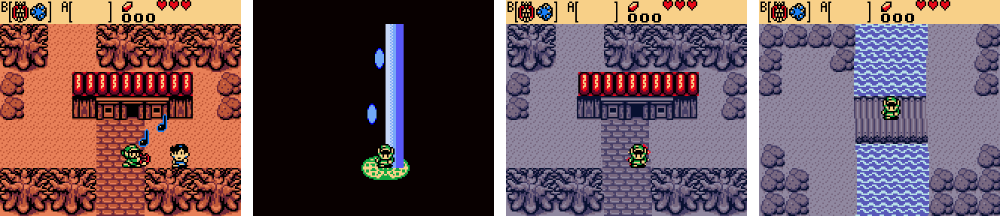
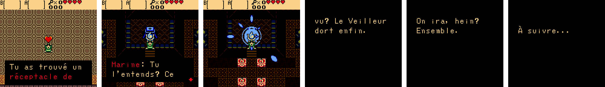

🇬🇧 [English version](README.en.md)

**▶ [La page du jeu](https://soaresden.github.io/ZeldaGullsOfLife/)**

# The Legend of Zelda: Gulls of Life

*La Ballade de la Mouette* : la suite de **Link's Awakening**, en ROM hack
Game Boy Color.

Le Poisson-Rêve s'est réveillé et l'île Cocolint a disparu… mais pas tout à
fait. Marine a fait un vœu : avoir des ailes pour partir au-delà de la mer. Elle
revient en **mouette**, et elle accompagne Link dans un archipel où plus
personne ne rêve.

*Gulls of Life* : *gulls* (les mouettes) sonne comme *goals* (les buts). C'est
la morale du jeu : on réalise ses rêves, on n'y reste pas, et on avance malgré
les obstacles.






## Jouer

**La démo (chapitre 1 et le Phare Éteint) :** télécharger `gulls_of_life.bps` dans les
[versions publiées](https://github.com/soaresden/ZeldaGullsOfLife/releases/latest), puis
l'appliquer sur sa propre ROM *The Legend of Zelda: Oracle of Ages* (USA, CRC32 `3800a387`)
avec un outil de patch BPS, par exemple [Rom Patcher JS](https://www.marcrobledo.com/RomPatcher.js/)
en ligne. Le fichier obtenu se joue dans n'importe quel émulateur Game Boy Color.

Aucune ROM n'est fournie ici.

## Où on en est

| Partie | État |
| --- | --- |
| Nouvelle partie : plus d'intro d'*Ages*, Link se réveille sur une plage | ✅ |
| Marine en mouette (sprite dessiné pour le jeu, avec sa fleur d'hibiscus) | ✅ |
| Chapitre 1 : Link évanoui, Marine arrive en volant, se pose et lui parle (choix de réponse), puis se glisse au chaud dans la tunique de Link | ✅ |
| Textes en français, avec les accents | ✅ |
| Film d'ouverture avant l'écran titre : à l'aube, Link dérive sur son rondin et lève les yeux ; le visage de Marine apparaît dans les nuages (comme à la fin secrète de *Link's Awakening*) et s'efface ; une mouette s'en envole et se pose, « ? », clin d'œil, « ! », ils sautent de joie tous les deux et leurs cœurs s'envolent | ✅ |
| Écran titre *Gulls of Life* (aujourd'hui : celui d'*Ages*) | à faire |
| Parler à Marine : un appui court sur **Select** (réplique selon l'endroit, sinon au hasard) ; Select maintenu ouvre la carte | ✅ |
| Répliques et indices de Marine pour chaque lieu de l'aventure | à faire |
| L'île de la Brume (16 écrans) : plage, port de pêche, Port-Veille et son auberge, sentier au pont cassé, bois, rochers, falaises, cap du Phare | ✅ |
| Les habitants de Port-Veille et leurs dialogues : l'aubergiste, le vieux pêcheur, les enfants qui ne jouent plus, la dame insomniaque, le vieux qui compte les moutons, l'ado qui rêve d'être marin | ✅ |
| L'auberge : on pousse le lit, Link s'endort et se réveille dans le **Songe** | ✅ |
| Le Songe : l'île en bleuté, l'écran qui ondule comme sous l'eau, Marine humaine (scène des mains) ; Select dans le Songe = se réveiller au même endroit | ✅ |
| Première énigme : le pont cassé du sentier est entier dans le Songe ; on le traverse en rêve et on se réveille de l'autre côté | ✅ |
| Les jeux du forain : Creuse-Rubis et Mamono (démineurs, quarts de cœur aux niveaux les plus durs) | à faire |
| Le vieux pêcheur rend son épée à Link (repêchée après le naufrage) | ✅ |
| Le Phare Éteint, sur 2 étages : petite clé, porte à clé, clé du boss, la **Lanterne des Songes**, l'escalier, la porte du boss et le **Veilleur Creux** | ✅ |
| Après le boss : le réceptacle de cœur, le premier couplet, la sortie sur le cap où Marine parle, puis « À suivre... » | ✅ |
| La Lanterne des Songes : dehors, un air fait passer du Réel au Songe et retour (si la case d'arrivée est dans l'eau, Link est renvoyé) | ✅ |
| Les retrouvailles dans le Songe : Marine se jette dans les bras de Link (des cœurs s'envolent) | ✅ |
| Musiques : la chanson de Marine, des thèmes inspirés des orchestres de *Hyrule Warriors* | à faire |

## Comment c'est fait

Le jeu repose sur le **moteur d'Oracle of Ages**, grâce au désassemblage
complet [oracles-disasm](https://github.com/Stewmath/oracles-disasm) de
Stewmath (branche `hack-base`, prévue pour les hacks). Le passage
présent/passé d'*Ages* sert au Réel et au Songe.

| Quoi | Où |
| --- | --- |
| Code, scripts, données | Branche [`hack/gulls-of-life`](https://github.com/soaresden/oracles-disasm/tree/hack/gulls-of-life) du fork (ajouts marqués `BALLADE`) : `scripts/ages/ballade.s`, `object_code/ages/interactions/marine.s` |
| Dialogues | `story/textes.yaml`, en français normal ; `tools/make_text.py` les ajoute au jeu, `tools/check_text.py` vérifie la largeur des lignes (16 caractères) |
| Sprites | Dessins en texte dans `art/` ; `tools/make_sprites.py` les convertit |
| Film d'ouverture | `code/ages/cutscenes/film.s` (fork) ; décor et sprites fabriqués par `tools/make_film.py` (ciel et nuages, soleil, mer, rondin, poses de Link prises dans le jeu, visage de Marine) ; `tools/preview_film.py` en donne un aperçu sans compiler |
| Salles | Plans texte dans `story/salles/` (10 x 8 briques par écran) et leurs objets dans `story/salles/objets.txt` ; `tools/make_rooms.py` les met dans le jeu ; `tools/catalog.py` photographie les briques d'un décor ou des salles avec leurs numéros |
| Carte | `tools/make_map.py` dessine `docs/carte_archipel.png` (les 8 îles, les routes du Bateau-Rondin, le plan de l'île de la Brume) |
| Tests | `tools/play.py` joue la ROM dans PyBoy et prend des captures ; `tools/test_phare.py` (le Phare jusqu'à la fin), `tools/test_lanterne.py`, `tools/test_fin.py` |
| Patch | `tools/make_patch.py` fabrique `out/gulls_of_life.bps` à partir de la ROM *Ages* (USA) |

Aucune ROM n'est distribuée ici : seulement le patch, à appliquer sur sa propre
ROM *Oracle of Ages* (USA).

## Compiler (Windows)

Prérequis : [MSYS2](https://www.msys2.org/) dans `C:\msys64` (avec `cmake`,
`make`, `mingw-w64-x86_64-gcc`) et Python 3 avec
`pip install pyyaml pillow pyboy`. Depuis Git Bash :

```bash
./setup.sh
```

```bash
./build.sh
```

La ROM sort dans `out/gulls_of_life.gbc`.

## Crédits

- Moteur et désassemblage : [oracles-disasm](https://github.com/Stewmath/oracles-disasm) de Stewmath et ses contributeurs.
- Marine humaine : graphismes de la branche `sprites/marin` d'oracles-disasm.
- *The Legend of Zelda* appartient à Nintendo ; ce projet est un hack fait par des fans, sans ROM.
